# Modelo de datos

Cada entidad de negocio tiene UUID, `created_at`, `updated_at`, `modified_by` y `revision`. La revisión permite detectar ediciones simultáneas. Claves foráneas `RESTRICT` evitan borrar referencias históricas. Las operaciones se auditan en la misma transacción, sin contraseñas, sesiones ni tokens. No se ofrece borrado físico desde la interfaz.

```mermaid
erDiagram
  users ||--o{ user_roles : tiene
  roles ||--o{ user_roles : asigna
  roles ||--o{ role_permissions : permite
  permissions ||--o{ role_permissions : define
  axes ||--o{ processes : organiza
  axes ||--o{ projects : agrupa
  projects ||--o{ milestones : tiene
  projects ||--o{ tasks : planifica
  tasks ||--o{ tasks : subtareas
  tasks ||--o{ task_assignments : equipo
  tasks ||--o{ task_dependencies : depende
  tasks ||--o{ task_updates : avances
  task_updates ||--o| task_update_reviews : revision_jefe
  evidence_versions o|--o{ task_updates : sustenta
  tasks ||--o{ closure_approvals : cierra
  document_types ||--o{ documents : clasifica
  documents ||--o{ document_versions : versiona
  documents ||--o{ documents : referencia
  tasks ||--o{ task_documents : vincula
  documents ||--o{ task_documents : reutiliza
  documents ||--o{ cases : tramita
  cases ||--o{ case_events : actuaciones
  meetings ||--o{ attendees : participantes
  documents ||--o{ meetings : acta
  meetings ||--o{ agreements : acuerda
  tasks o|--o| agreements : deriva
  evidence ||--o{ evidence_versions : versiona
  evidence_versions ||--o{ evidence_validations : valida
  evidence ||--o{ evidence_links : relaciona
  tasks ||--o{ evidence_links : verifica
  service_orders ||--o{ deliverables : entrega
  documents o|--o{ deliverables : presenta
  deliverables ||--o{ deliverable_reviews : conformidad
  quality_models ||--o{ criteria : contiene
  criteria ||--o{ indicators : mide
  indicators ||--o{ indicator_results : resultado
  periods ||--o{ indicator_results : periodo
  indicators ||--o{ improvement_plans : mejora
  import_batches ||--o{ import_sources : origen
```

`evidence_links` tiene claves a tarea, documento, acuerdo, reunión, proyecto o indicador y exige exactamente un destino. Cada vínculo se crea una vez. Los documentos son únicos por número/año/tipo/emisor. Los resultados son únicos por indicador/periodo. Un acuerdo genera una sola tarea, de forma idempotente. Las dependencias se validan para impedir ciclos.

Una validación pertenece a una **versión** de evidencia; subir una nueva versión obliga a validarla antes del cierre. El cierre guarda la versión utilizada o una justificación explícitamente autorizada por jefatura/administración. Se exige revisión y dependencias cerradas. Los avances y comentarios son registros históricos.

En documentos emitidos, `preparation_status` registra preparación y envío digital, físico o ambos, con `sent_date`. La interfaz muestra `document_status` y no solicita aprobar cartas. `approval_status` se conserva para la atención de documentos recibidos y el historial previo. Las derivaciones cambian la dependencia externa, no el responsable OGC. Las conformidades OS requieren documento de presentación y revisor con permiso de validación. La comparación con cada campo del Excel está en [Revisión del registro](revision-campos-registro-2026-10-14.md).

Modelos y criterios de calidad empiezan en `pendiente_validacion`; el catálogo de demostración es ficticio, no una transcripción de normativa. Debe validarse fuente, versión y aplicabilidad antes de activar estándares institucionales.

Migraciones: Alembic inicial con metadata congelada en SQL PostgreSQL, esquema equivalente SQLite para pruebas. No se da por probado PostgreSQL por el solo hecho de compilar SQL: se requiere ejecutar en una instancia y verificar las restricciones.

La migración aditiva 002 añade `tasks.created_by`, `task_assignments.assigned_by`, `task_updates.evidence_version_id` y `task_update_reviews`. Los autores de avances y revisores provienen de la sesión; los campos de procedencia no se aceptan por CRUD. Las revisiones son inmutables, únicas por envío y contienen resultado, nota y revisor. La revisión del jefe crea también una validación de la versión de evidencia dentro de la misma transacción. El porcentaje de cada persona se calcula desde su historial; no hay una columna que permita sobrescribir el aporte de otra persona. Añadir un participante recalcula el consolidado.

002 conserva los registros anteriores y recupera la autoría de creación únicamente de eventos de auditoría de creación/importación. Los datos sin un evento recuperable permanecen sin autor inferido. Las dos migraciones tienen SQL congelado separado para PostgreSQL/SQLite; 001 no se modifica.
